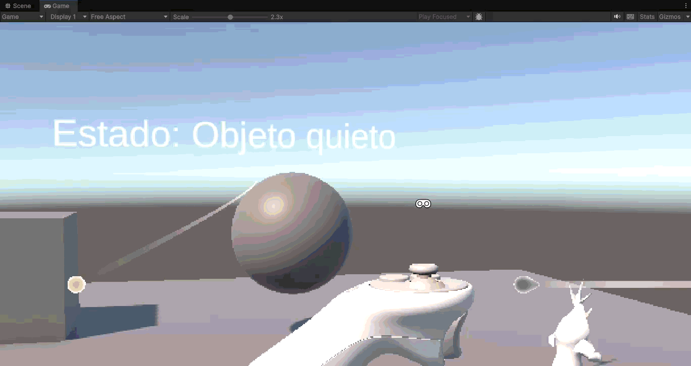

# Practica6-InterfacesInteligentes

## Ejercicio

- El cubo tiene collider, rigidbody cinemático y es XR Simple Interactable.
- La esfera tiene collider, rigidbody cinemático y es XR Grab Interactable.
- El objeto de la store tiene collider, rigidbody y es XR Grab Interactable.

Las funciones utilizadas fueron OnEnable(), OnDisable(), OnGrabbed(), OnReleased(), OnSelectEntered() y OnSelectExited().